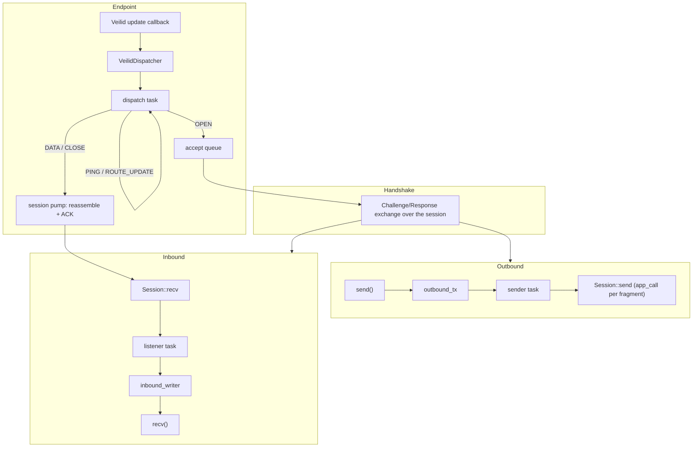

# Subduction Veilid

> [!WARNING]
> This is an early release preview. It has a very unstable API. No guarantees are given. DO NOT use for production use cases at this time. USE AT YOUR OWN RISK.

Privacy-preserving P2P transport layer for the [Subduction](https://github.com/inkandswitch/subduction) sync protocol over [Veilid](https://veilid.com/) private routes. Peers are reachable through an opaque _route blob_ (or a stable DHT address that resolves to it) instead of an IP address; traffic is end-to-end encrypted and relayed over multiple hops, so neither side learns the other's network location. Native-only (no Wasm support).

## Architecture

Veilid delivers every inbound message through a single update callback, so a `VeilidEndpoint` owns the node's private route and demultiplexes Veilid app calls into reliable `Session`s. After the Subduction handshake, a session backs a `VeilidTransport`, which has the same internal layout as the Iroh, WebSocket, and HTTP long-poll transports:



The `call()` method uses the same pending-map + oneshot pattern as the other transports for request-response correlation.

### Setting up an endpoint

- `VeilidEndpoint::start(veilid_config, EndpointConfig, forward)` starts and attaches a Veilid node, allocates a private route (retrying while the network warms up), and binds the endpoint. Updates the endpoint does not consume are passed to the optional `forward` callback. `shutdown()` also shuts the node down. Attaching can take minutes on a cold start: `VeilidEndpoint::start_until(.., cancel)` does the same but stops as soon as the `cancel` future completes, shutting the half-started node down cleanly (`EndpointError::Cancelled`).
- If your application already runs a Veilid node, create a `VeilidDispatcher`, call `dispatcher.handle_update(update)` from your update callback (or use `dispatcher.update_callback(..)`), then `VeilidEndpoint::bind(api, &dispatcher, config)`. The endpoint then owns **all** `AppCall`s on that node; `shutdown()` leaves the node running, and the endpoint keeps refusing app calls (as unknown sessions) until its last handle is dropped. A dispatcher binds to one endpoint only; stop forwarding updates to it once the endpoint is gone.
- `endpoint::node_config(program_name, namespace, data_dir)` builds a `VeilidConfig` that keeps all Veilid state under `data_dir`. `program_name` + `namespace` must be unique among Veilid nodes running concurrently in one process. It also calls `data_dir::prepare_data_dir(data_dir)` (best effort, logged); call that yourself to handle errors. See [Data directory](#data-directory).

Give peers `endpoint.address()` (stable, see below) or `endpoint.route_blob()`; they pass it to `client::connect_address` (or the blob to `client::connect`). The server side loops over `server::accept_one` (feature `server`, on by default).

### Addresses

A route blob names one _allocation_ of a node's private route: it goes stale when the node reallocates its route (route churn) and on every restart. So by default (`EndpointConfig::publish_address`) the endpoint also publishes its current route blob into a Veilid DHT record it owns (single-owner `DFLT(1)` schema, subkey 0, value `0x01 | blob`) and rewrites it on every route (re)allocation (and hourly). The record's owner keypair and key are persisted (`EndpointConfig::address_key_store`: Veilid's table store by default, or `AddressKeyStore::File(path)`, mode `0600`), so the record key is a **stable address** across route changes and restarts.

- `VeilidEndpoint::address() -> Option<VeilidAddress>`: our DHT address, once the record is set up (shortly after start). `wait_address_published().await` waits until our _current_ route is readable there. If the persisted record has vanished from both the local store and the network (`KeyNotFound`, e.g. keys reused on a fresh data directory long after the node was last online), it cannot be recreated under the same key: the endpoint logs an error and keeps retrying, and the operator must remove the persisted keys to get a new address.
- `VeilidAddress` (`Display` / `FromStr`) is either `Record(RecordKey)` (Veilid's string form `VLD0:<key>:<encryption key>`, always contains `:`) or `RouteBlob(bytes)` (URL-safe base64 without padding, never contains `:`; the format earlier versions used).
- `client::connect_address(&endpoint, &address, &signer, audience)` (or `endpoint.open_session_to(&address)` for a raw session) resolves a DHT address to the peer's **current** blob on every call (`get_dht_value` with `force_refresh`), so redialling a peer by address keeps working after it moved. `endpoint.resolve(&address)` does just the lookup.

[`subduction_cli`](../subduction_cli/README.md#veilid-options) uses all of this. It writes its address to the ready file as `veilid_address`, and its `--veilid-peer` takes either form. Each peer is kept connected by a supervisor that calls `connect_address` again, with backoff, whenever the session closes.

### Route changes

Private routes die: relays change, hops disappear, and Veilid expires its cached copies of remote routes. Sessions ride this out instead of closing:

- **Peer's route reported dead** (`RouteChange::dead_remote_routes`), or sends to it failing with `InvalidTarget` / repeated `NoConnection`: the session re-imports the peer's saved route blob (from its OPEN, the address we dialled, or its latest ROUTE_UPDATE) and carries on. Often the route was fine and only our copy expired. If re-importing fails (or the re-imported route fails too), the session enters a **route-lost** state: sends and keepalives _wait_ (they do not fail) for up to `EndpointConfig::route_recovery_timeout` (2 min) for the peer to announce a new route; only then is the session closed.
- Each re-import is installed _before_ the failing copy is released, and sessions that share one imported route each re-import it (Veilid returns the same `RouteId` and every session holds its own reference), so recovering never makes Veilid drop a route another session still uses. A freshly installed route, even one with the same `RouteId`, gets a fresh retry budget.
- **Our route reported dead**: sessions stay open, a new route is allocated (retrying until it works), announced to every live session's peer with a ROUTE_UPDATE frame (retried for up to `route_recovery_timeout`), and republished to our DHT address.

## Session protocol

Every frame is the payload of one Veilid `app_call` (at most 32 768 bytes). The reply is a two-byte ACK/NACK status, so every frame is acknowledged.

```text
header (18 bytes):  version u8 | kind u8 | session_id [16 random bytes, chosen by the initiator]

OPEN  (1): header | initiator's route blob   (responder imports it to talk back)
DATA  (2): header | seq u64 | frag_idx u32 | frag_count u32 | chunk  (integers big-endian)
CLOSE (3): header | code u32 | reason (UTF-8, <= 123 bytes)
PING  (4): header   (keepalive; ACKed while the session exists)
ROUTE_UPDATE (5): header | generation u64 | sender's new route blob

reply:     version u8 | status u8   (0 ACK, 1 unknown session, 2 busy, 3 protocol, 4 too large)
```

- Messages are split into chunks of up to 32 734 bytes (an empty message is one empty fragment). The sender sends fragments **strictly sequentially**, waiting for each ACK. Retryable Veilid errors (`Timeout`, `TryAgain`, `NoConnection`) and local call timeouts are retried with bounded exponential backoff, up to `max_send_attempts`.
- The receiver delivers in order. A copy of any fragment it already accepted (a retransmit after a lost ACK, or a stale copy of an earlier attempt delivered late) is ACKed again but not redelivered; a fragment _ahead_ of the expected one is a protocol error that closes the session.
- An "unknown session" NACK means the peer no longer has the session: the sender treats it as a disconnect.
- ROUTE_UPDATE is handled by the receiver's dispatcher: it imports the blob and switches the session to it (keeping refcounts of imported routes per session). `generation` increases with every reallocation of the sender's route, so a late retransmit of an older update is ACKed but ignored; an unimportable blob is NACKed as a protocol error.
- **Backpressure:** a "busy" NACK means the receiver did _not_ consume the fragment. The pump never blocks: when the consumer's queue is out of room (`inbound_queue_capacity` messages or `max_buffered_bytes`), the fragment completing a message is refused as busy. The sender keeps retrying busy fragments with backoff for up to `max_busy_wait` (5 min) without spending its attempt budget, so a slow consumer slows the sender down instead of breaking the session.
- **Before authentication** (until `Session::mark_established`, which `client::connect` / `server::accept_one` call when the handshake succeeds), a session accepts only messages of at most `unauthenticated_max_message_size` (64 KiB) and buffers no more than that; larger fragments are refused as busy. Inbound sessions not established within `handshake_timeout` of their OPEN (including time in the accept queue) are closed.
- **Liveness:** every `keepalive_interval` (30 s) each side sends a PING. If it fails (unknown session, or retries exhausted) the session is closed, so a peer that vanished without a CLOSE is detected even on a receive-only session. A session whose peer route is lost is not torn down by its keepalive: the PING waits for the route like any other frame, and the session closes only when `route_recovery_timeout` expires. CLOSE frames are retried like any other frame (for up to `call_timeout`; `close_timeout` during endpoint shutdown).
- Close codes mirror `subduction_iroh` and WebSocket: `0` normal, `1009` message too big, `1011` internal error.

### Limits

| Limit                                        | Default            | Where                         |
|----------------------------------------------|--------------------|-------------------------------|
| Reassembled message size                     | 50 MiB             | `EndpointConfig::max_message_size` (matches `subduction_iroh`) |
| Fragments per message                        | ⌈limit / 32 734⌉   | checked from the header before allocating |
| Message size / buffer before authentication  | 64 KiB             | `EndpointConfig::unauthenticated_max_message_size` |
| Buffered reassembled bytes per session       | 16 MiB (one message always fits) | `EndpointConfig::max_buffered_bytes` |
| Buffered reassembled messages per session    | 128                | `EndpointConfig::inbound_queue_capacity` |
| Open sessions (incl. not yet accepted)       | 256                | `EndpointConfig::max_sessions` |
| Sessions waiting for `accept`                | 32                 | `EndpointConfig::accept_queue_capacity` |
| Handshake duration (connect and accept)      | 60 s               | `EndpointConfig::handshake_timeout` |
| Waiting for a lost peer route to come back   | 120 s              | `EndpointConfig::route_recovery_timeout` |

## Security

- **Veilid private routes are anonymous.** An inbound app call carries no usable sender identity, so there is no transport-level peer authentication (unlike Iroh's TLS). The Subduction handshake (`Signed<Challenge>` / `Signed<Response>`) run over each session is the **only** authentication of the remote peer.
- The **session id is effectively a bearer secret** for its session (but not an identity: that comes from the handshake alone). It is a 128-bit random value that demultiplexes frames arriving on the endpoint's single route, and whoever knows it can inject frames into the session, including a ROUTE_UPDATE that redirects our replies to a route of their choosing. It only ever travels inside Veilid's end-to-end encrypted private routes (it is never published, e.g. not in the DHT), so off-path attackers can neither learn nor guess it. A party that could read session ids could also read the session traffic itself; Subduction messages are additionally signed, so a redirected session can be disrupted but not used to impersonate the authenticated peer.
- Anyone holding the route blob can open sessions. Session count, the pending-accept queue, pre-authentication message size and buffering (64 KiB per session), and time to authenticate are all bounded so unauthenticated peers cannot exhaust memory or hold sessions indefinitely. The reassembly buffer grows with the data actually received, never with the announced fragment count.
- `node_config` stores the node's Veilid secrets in files under the data directory (as `veilid-server` does), since an OS keyring is usually unavailable on servers. Protect that directory.
- **DHT address.** The address record key includes the record's encryption key, so it is the read capability for our current route blob: sharing the address is equivalent to sharing the blob (anyone holding it can open sessions). The record's owner keypair (the write capability, i.e. who can redirect the address) is persisted in Veilid's encrypted table store or in the `AddressKeyStore::File` (mode `0600`): protect it like the node's other secrets. Publishing reveals nothing about our network location (the blob is a private route), but it does let anyone with the address see _when_ our route changes.

## Data directory

Veilid refuses to open its stores unless every directory and file it uses is owned by the process's effective user **and group** ("path has incorrect owner/group"). On macOS/BSD new files inherit the group of their parent directory (e.g. `wheel` under `/tmp`), and on Linux the same happens under a setgid directory. `data_dir::prepare_data_dir(dir)` creates the directory and `chown`s it and the entries in it that we own to our effective group (symlinks are not followed), after which files Veilid creates inherit the right group. It is a no-op beyond creating the directory on non-Unix platforms. `node_config` calls it.

## Performance

Each fragment costs a full multi-hop round trip through private routes, and fragments are sent one at a time, so throughput per session is roughly `32 KiB / RTT`. Private-route round trips are typically hundreds of milliseconds, so expect tens to low hundreds of KiB/s per session: fine for incremental sync, slow for large initial syncs of big documents. Use Veilid for the privacy properties, not for bulk transfer.

## Testing

Integration tests run against veilid-core's `mock-api` feature, an in-process simulated network: no sockets, attach is instant, route blobs are just route ids, and the DHT is simulated (records persist across node restarts within the process). The mock is enabled through a `dev-dependency` feature. Route churn is simulated by injecting `VeilidUpdate::RouteChange` through a `VeilidDispatcher` (bind mode), exactly as Veilid delivers it (`tests/resilience.rs`); addresses are covered in `tests/address.rs`.

Tradeoff: Cargo unifies features, so any build that compiles this crate's dev targets (`cargo test -p subduction_veilid`, `cargo test --workspace`, `cargo build --all-targets`) also builds the library, and any binary in that build, against the mock. Plain `cargo build` / `cargo run` of a binary are unaffected. Downstream crates can opt into the mock for their own tests with this crate's `mock-api` feature; never enable it in production.

To make an accidental mock build impossible to miss, an endpoint bound to the mock network logs an error and reports `VeilidEndpoint::is_mock_network() == true`; `subduction_cli` refuses to start its Veilid transport in that case.

```sh
cargo test -p subduction_veilid
```

## Platform Support

This crate is **native-only** (Tokio) and does not support Wasm. For browser environments, use `subduction_websocket` or `subduction_http_longpoll`.

## License

See the workspace [`LICENSE`](../LICENSE) file. Note that the `veilid-core` dependency is licensed under **MPL-2.0** (file-level copyleft): this crate links it unmodified, but distributors of binaries must make `veilid-core`'s source (including any modifications to it) available under MPL-2.0.
